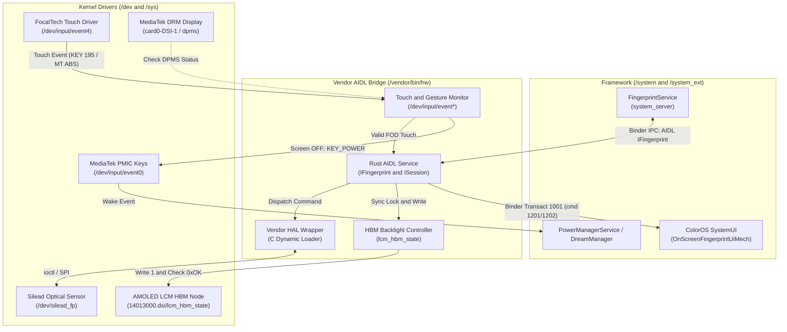
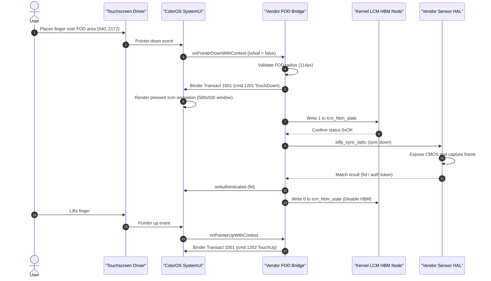
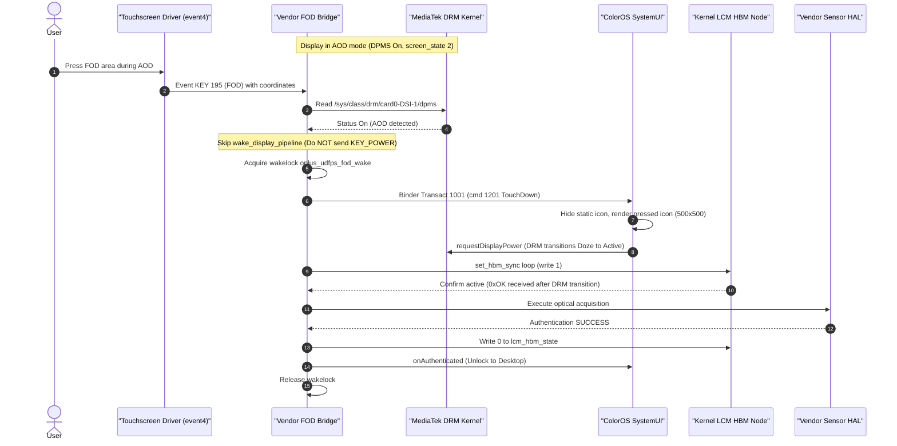
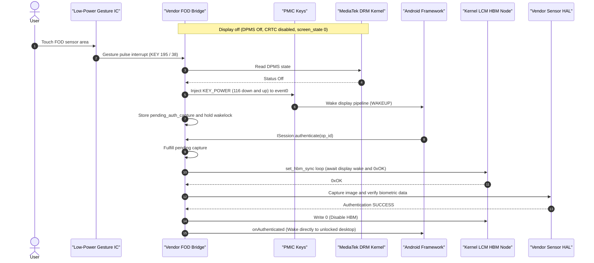

# OPlus UDFPS Bridge for Transsion (Vendor AIDL HAL)

A native Rust daemon that implements the Android AIDL fingerprint HAL (`android.hardware.biometrics.fingerprint.IFingerprint`) for Transsion devices (Tecno and Infinix on MediaTek Helio G99 / MT6789 / Dimensity platforms) running ported ColorOS 16 / 17 (Android 14+) or custom ROMs.

The entire implementation operates inside the `/vendor` partition. It requires no modifications to `/system` or `/system_ext`.

---

## 1. Technical Context & Problem Statement

### HAL Generation Incompatibility
- **Transsion KJ7 Base**: Stock Transsion vendor implementations use legacy HIDL HAL interfaces (`android.hardware.biometrics.fingerprint@2.1/2.3`).
- **ColorOS Framework**: ColorOS 16 and 17 (Android 14+) require an AIDL HAL service (`android.hardware.biometrics.fingerprint.IFingerprint`). In addition, the ColorOS `OnScreenFingerprintUiMech` framework relies on vendor-specific Binder IPC transactions on `ISessionCallback` (transaction 1001 with command 1201 for `TouchDown` and command 1202 for `TouchUp`).

### MediaTek Kernel HBM Gating
- Optical under-display fingerprint sensors (Silead GSL7001 / Goodix) require the AMOLED display area above the sensor to illuminate at High Brightness Mode (HBM) during optical acquisition.
- In the MediaTek DRM display driver (`tran_lcm_hbm_set`), writing to the HBM control node is rejected if the display controller is in sleep or doze:
  ```c
  if (!crtc->enabled || !dsi->enabled || dsi->is_doze) {
      pr_err("display state is slept or idle, skip set hbm node.\n");
      return;
  }
  ```
  Attempting to toggle HBM before the DRM driver fully transitions from doze to active causes HBM activation to fail silently.

### AOD & Sleep Power Conflicts
- **Premature Dream Termination**: If an input handler injects `KEY_POWER` (keycode 116) while the device is in Always-On Display (AOD / Doze), `PowerManagerService` processes it as a physical power key press (`WAKE_REASON_POWER_BUTTON`). This triggers `DreamManager.stopDream()`, tearing down the AOD display window and destroying the on-screen fingerprint icon.
- **Empty Pressed Icon Window**: ColorOS SystemUI renders a dynamic press animation window (`OnScreenFingerprintPressedIcon`) when touch begins. If optical configuration properties (`persist.vendor.fingerprint.optical.iconsize` and `iconnumber`) are unset or set to `0` / `"none"`, SystemUI initializes this window with dimensions `0x0`. In AOD, the static icon hides to let the pressed icon render, but because the pressed icon has zero size, the fingerprint indicator completely vanishes on contact.

---

## 2. Architecture & Design

- **Native Rust AIDL Implementation**: Implements `IFingerprint` and `ISession` using `rsbinder`. Directly handles custom ColorOS transactions:
  - Command 1010: Total enrollment steps.
  - Command 1011: Screen state synchronization.
  - Transaction 1001 (commands 1201/1202): Direct touch dispatch to ColorOS SystemUI.
- **Dynamic C Vendor Loader**: Loads the patched stock vendor binary (`libsl_fp_impl.so`) via `dlopen`/`dlsym`. Dispatches commands across a dedicated worker pool and strips non-standard vendor acquired messages (1001, 1002, 1020) that would otherwise cause framework errors.
- **Synchronous HBM Controller**: Writes to `/sys/devices/platform/soc/14013000.dsi/lcm_hbm_state` in a polling loop until the kernel confirms the state change with `0xOK`. Synchronized with SystemUI display power requests (`requestDisplayPower`).
- **Context-Aware Wake Engine**: Inspects the DRM panel state via `/sys/class/drm/card0-DSI-1/dpms`:
  - When DPMS is `Off` (deep sleep): Injects `KEY_POWER` into `/dev/input/event0` (PMIC keys) to wake the hardware display pipeline.
  - When DPMS is `On` (screen active or AOD): Suppresses power key injection completely. Holds an in-kernel wake lock (`oplus_udfps_fod_wake`) and lets ColorOS SystemUI transition the panel power state without breaking the AOD Dream lifecycle.
- **Safe Fallback Configuration**: Automatically initialises required optical properties at startup: `iconsize=500`, `iconlocation=228`, and `iconnumber=0`.

---

## 3. System Diagrams

### Component Architecture



---

### Sequence 1: Screen ON Authentication

During normal screen-on conditions, the display pipeline and touch drivers run at full operational power.



---

### Sequence 2: Always-On Display (AOD / Doze) Authentication

In AOD mode, the AMOLED panel operates in low-power mode (`dpms = On`). Power button injection is bypassed to keep the AOD dream window intact.



---

### Sequence 3: Screen OFF (Deep Sleep) Authentication

When the screen is completely powered off (`dpms = Off`), the SoC enters deep sleep. Low-power gesture pulses from the touch IC prompt a physical power event to resume the display controller.



---

## 4. File Layout & Vendor Integration

All artifacts install strictly into `/vendor`:

```
/vendor/
├── bin/
│   └── hw/
│       └── android.hardware.biometrics.fingerprint-service.transsion   # Main Rust AIDL HAL binary (0755)
├── etc/
│   ├── init/
│   │   ├── android.hardware.biometrics.fingerprint-service.transsion.rc # AIDL service init config (0644)
│   │   ├── android.hardware.biometrics.fingerprint@2.1-service-mediatek.rc # Legacy HIDL service override (disabled)
│   │   └── android.hardware.biometrics.fingerprint@2.3-service.transsion.rc # Legacy HIDL service override (disabled)
│   └── vintf/
│       └── manifest/
│           ├── manifest_fingerprint_transsion.xml                      # VINTF AIDL IFingerprint declaration (0644)
│           ├── android.hardware.biometrics.fingerprint@2.1-service-mediatek.xml # Legacy VINTF stub
│           ├── android.hardware.biometrics.fingerprint@2.3-service.transsion.xml # Legacy VINTF stub
│           └── manifest_fingerprint.xml                                # Legacy VINTF stub
└── lib64/
    └── libsl_fp_impl.so                                                # Patched Silead vendor library (0644)
```

---

## 5. Source Code Structure

| Module | File | Purpose |
|---|---|---|
| **Entrypoint** | [src/main.rs](src/main.rs) | Sets up Binder thread pool, registers the AIDL service with `ServiceManager`, and enforces fallback optical properties (`iconsize=500`, `iconlocation=228`, `iconnumber=0`). |
| **AIDL Service** | [src/service.rs](src/service.rs) | Implements `IFingerprint` and `ISession`. Handles proprietary ColorOS transactions (cmd 1010 for enrollment steps, cmd 1011 for screen state, cmd 1201/1202 for touch dispatch). |
| **HAL Wrapper** | [src/hal.rs](src/hal.rs) | Wraps vendor C `fingerprint_device_t` methods via `dlopen`/`dlsym`. Filters non-standard internal vendor codes (1001, 1002, 1020) and manages pending capture queues. |
| **Input Monitor** | [src/input.rs](src/input.rs) | Reads touch events from `/dev/input/event*`, validates coordinates against the FOD area radius (114px around 540, 2172), and injects `KEY_POWER` only when DPMS is `Off`. |
| **HBM Controller** | [src/hbm.rs](src/hbm.rs) | Manages AMOLED panel brightness mode via `/sys/devices/platform/soc/14013000.dsi/lcm_hbm_state`. Polls for `0xOK` with a 500ms safety timeout. |
| **Binary Patcher** | [patch_libsl_fp.py](patch_libsl_fp.py) | Patches `libsl_fp_impl.so` to eliminate `silfp_cust_wait_ui_ready` latency, bypass blocking ioctl `wait_finger_status`, and adjust enrollment challenge checks. |

---

## 6. System Properties

The following system properties configure optical sensor geometry and framework behavior:

```properties
# Enables AIDL HAL detection in ColorOS biometric framework
vendor.fingerprint.aidl.support=1

# Prevents the framework from disabling the touch screen during auth
persist.sys.block.fingerprint=false

# Dimensions of the pressed icon animation window in pixels (w x h)
persist.vendor.fingerprint.optical.iconsize=500

# Vertical offset of the optical icon from screen bottom
persist.vendor.fingerprint.optical.iconlocation=228

# Physical center coordinates of the sensor (X::Y)
persist.vendor.fingerprint.optical.sensorlocation=540::2172

# ColorOS pressed animation style index (0 = Default)
persist.vendor.fingerprint.optical.iconnumber=0

# SystemUI animation render mode (2 = Frame-by-frame webp drawables)
persist.sys.oplus.anim_level=2
```

---

## 7. Build Instructions

### Prerequisites
- **Host OS**: Linux x86_64
- **Rust Toolchain**: `rustup target add aarch64-linux-android`
- **Android NDK**: NDK r26b or newer (`ANDROID_NDK_HOME` must be set)
- **Python**: Python 3.8+ (for binary patching)

### Compiling
Run the build script:

```bash
./build.sh release
```

The build script performs the following tasks:
1. Validates the NDK toolchain and locates the `aarch64-linux-android31-clang` compiler.
2. Compiles the Rust workspace for `aarch64-linux-android` with release profile optimizations and runs `llvm-strip`.
3. Executes `patch_libsl_fp.py` on `libsl_fp_impl.so`.
4. Assembles the `/vendor` tree inside `out/vendor/`.
5. Generates the distribution archive `out/transsion-vendor-fod-package.zip`.

---

## 8. Deployment

The build output is available in `out/transsion-vendor-fod-package.zip` and `out/vendor/`.

### Method 1: Vendor Image Integration (ROM Source)
Copy the contents of `out/vendor/` directly into your ROM's vendor source tree or unpacked `vendor.img`:
- Executable binary in `vendor/bin/hw/`: mode `0755`, SELinux context `u:object_r:hal_fingerprint_default_exec:s0`.
- Shared library in `vendor/lib64/`: mode `0644`.
- Configuration files in `vendor/etc/`: mode `0644`.

### Method 2: Manual Recovery Push (TWRP / OrangeFox)
For testing on an existing installation:

```bash
adb root
adb remount
adb push out/vendor /
```

---

## 9. Verification & Diagnostics

Verify service status and operation using ADB.

### 1. Check Service Registration
```bash
adb shell dumpsys activity service android.hardware.biometrics.fingerprint.IFingerprint/default
```

### 2. Monitor Authentication and HBM Logs
```bash
adb logcat -s oplus_udfps_transsion fingerprint
```

Typical output during successful authentication:
```text
I oplus_udfps_transsion: FOD touch detected in sleep at (540, 2172) (KEY 195, screen_state=2) -> activating HBM and capture
I oplus_udfps_transsion: notify_framework_touch(true): dispatched ColorOS binder transact 1001 (cmd 1201)
I oplus_udfps_transsion: Hardware LCM HBM confirmed active (0xOK) in 248ms (attempts=12)
I oplus_udfps_transsion: Authentication SUCCEEDED for fid 2144737483
I oplus_udfps_transsion: Hardware LCM HBM disabled
I oplus_udfps_transsion: notify_framework_touch(false): dispatched ColorOS binder transact 1001 (cmd 1202)
```

### 3. Verify Pressed Icon Window Dimensions
Confirm that the SystemUI animation window has valid dimensions (`500x500` rather than `0x0`):
```bash
adb shell "dumpsys window windows | grep -A 10 'OnScreenFingerprintPressedIcon'"
```
The output should report `Requested w=500 h=500`.
